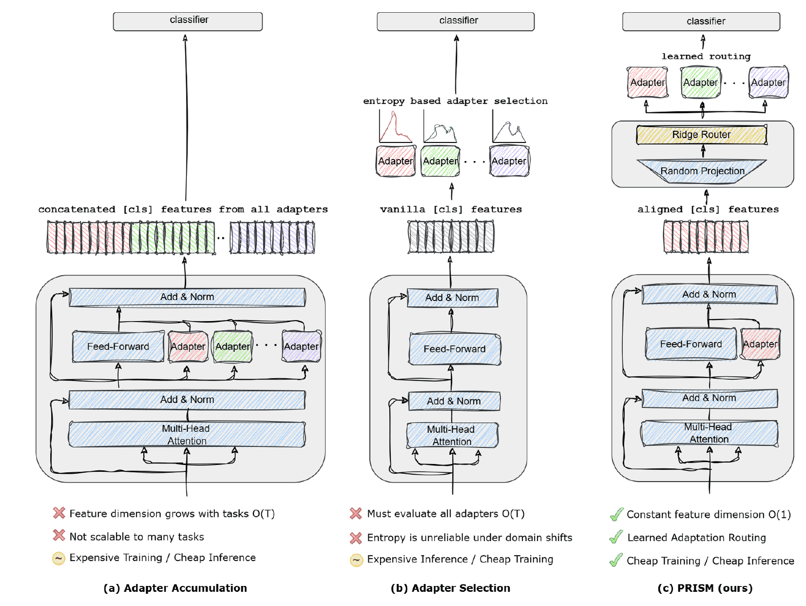
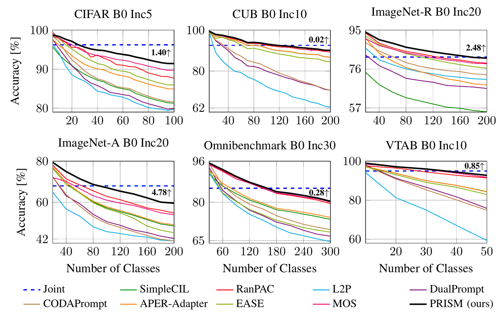

# PRISM: Projected Routing In Scaled-up Mappings for Continual Post-Training

<p align="center">
  <a href="#-introduction">🎉 Introduction</a> •
  <a href="#️-method">🏗️ Method</a> •
  <a href="#-results">📊 Results</a> •
  <a href="#️-how-to-use">☄️ How to Use</a>
</p>

> **PyTorch implementation of PRISM**, currently under double-blind review.

---

## 🎉 Introduction

Continual post-training of pre-trained models offers a promising way to acquire new classes while retaining a shared representation and allocating adaptation capacity to individual tasks. However, this setting introduces a fundamental inference problem: **the task associated with an input is unknown**, yet selecting the correct task-specific adaptation is necessary for accurate classification.

Existing approaches either concatenate features from all task-specific modules, which grows the representation dimensionality, or evaluate every module under a selection criterion such as distance or predictive entropy. The latter family is effective when the correct expert is selected, but expert selection remains the bottleneck: batch-level criteria assume that test samples belong to the same task, while the per-sample alternative requires evaluating every stored module, making inference cost grow linearly with the number of tasks.

**PRISM** (Projected Routing In Scaled-up Mappings) explicitly separates *task identification* from *classification*. It learns a globally consistent router in a high-dimensional random feature space, enabling instance-wise selection of a single task-specific adaptation module without evaluating all adapters. This design provides **constant-path inference** while maintaining a shared routing function throughout the continual sequence.

Our main contributions:

- We identify **task routing as a distinct inference problem** in modular continual post-training. As task-specific modules accumulate, a model must determine the appropriate adaptation for each test instance without access to its task identity, while supporting arbitrary test-batch compositions.
- We introduce PRISM, an **instance-wise router estimated in closed form** over accumulated sufficient statistics in a high-dimensional random feature space. Because the router is never updated by gradient descent on the current task alone, it does not inherit the forgetting dynamics of the sequence it is meant to index. It activates exactly one task-specific module per input, yielding `O(1)` adapter evaluations in the number of tasks.
- We demonstrate the effectiveness of PRISM across **six standard class-incremental benchmarks**, where it delivers larger improvements under challenging distribution shifts while substantially reducing the inference cost associated with multi-module evaluation.

---

## 🏗️ Method

<p align="center">
  
</p>

**Use of per-task adapters in continual post-training.** (a) Concatenating `[CLS]` features from all adapters grows the representation dimensionality with the number of tasks. (b) Entropy-based selection evaluates every adapter, which grows inference cost linearly. (c) PRISM gates the lifted `[CLS]` feature with a closed-form ridge router, evaluating one adapter at constant cost.

Three observations constrain any routing mechanism for modular continual post-training. Routing must be **instance-wise**, since batch-level criteria are only valid when test samples share a task. It must be **nonlinear** in the frozen representation, since tasks are not separable in the `[CLS]` space. And it cannot be obtained by gradient descent on the arriving task, since a router updated this way is itself a class-incremental learner and inherits the forgetting it was introduced to remove. These constraints admit a narrow design space:

> **Key design principle.** Every component whose behaviour must span tasks is estimated in closed form from accumulated statistics. Every component trained by gradient descent observes one task and is never updated again.

PRISM therefore has three parts:

- **Shared representation** (`backbone/vit_adapter.py`) — a frozen ViT-B/16 with MLP adapters at every block, trained on the first task and frozen thereafter. Since it is read by both the router and every expert, it may only be trained at the one point where doing so cannot overwrite anything.
- **Task experts** (`backbone/vit_prism.py`) — per task, a bottleneck MLP (`dim → dim/mlp_ratio → dim`) residually added and normalized, then gated by a Squeeze-and-Excitation block (`dim → dim/se_ratio → dim`), followed by a `CosineLinear` head over that task's own classes. Each expert is fitted on one task alone and distinct tasks own disjoint parameters, so **the experts cannot interfere**. An L1 penalty keeps the adaptation sparse.
- **Analytic router** (`models/prism.py`) — the frozen feature is lifted through a random projection with a ReLU, into a space of dimension `D ≫ d`. The projection is drawn **once**, before the sequence begins, so every task is embedded in a common routing space and no realignment is needed when a task is added. A ridge classifier over that space predicts the task, and the top-1 task's expert then classifies within it.

The router's ridge is accumulated as two running sums — a Gram matrix and a class-sum matrix — and re-solved in closed form after each task, adding one column per task. No sample from any previous task is revisited or stored, so the method stays rehearsal-free. Because addition is commutative, the result is **provably identical** to a ridge fitted with simultaneous access to every task, in any task order: the router does not *resist* forgetting so much as have no mechanism by which forgetting could occur, since its estimate at one session is not a function of the previous one.

---

## 📊 Results

<p align="center">
  
</p>

**Last accuracy after each session under shuffled (instance-wise) inference**, averaged over five seeds, using ViT-B/16-IN21K. Annotations give PRISM's gain over the runner-up at the final session.

Gains are largest where the pre-trained representation is weakest: they are significant on ImageNet-A, ImageNet-R and CIFAR (`p < 0.01`), while on CUB, OmniBenchmark and VTAB the frozen features are near-saturated and we claim parity rather than improvement.

PRISM reaches this accuracy at ≈ 15–20 GFLOPs/sample and ≈ 3 ms/sample — the cost of a single backbone forward pass plus one routed adapter — against the ≈ 380–400 GFLOPs/sample of expert-selection methods that must evaluate every stored module, i.e. roughly **22× less inference compute**.

---

## ☄️ How to Use

### 🗂️ Dependencies

With [uv](https://docs.astral.sh/uv/) (a lockfile is committed):

```bash
uv sync
```

Or with pip (Python ≥ 3.11):

```bash
pip install torch torchvision timm numpy scipy pillow tqdm easydict
```

### 📂 Dataset Preparation

PRISM supports the following benchmarks:

| Dataset | Config file |
|---|---|
| CIFAR-100 | `exps/prism_cifar.json` |
| CUB-200 | `exps/prism_cub.json` |
| ImageNet-A | `exps/prism_ina.json` |
| ImageNet-R | `exps/prism_inr.json` |
| OmniBenchmark | `exps/prism_omni.json` |
| VTAB | `exps/prism_vtab.json` |

For **CIFAR-100**, the dataset is downloaded automatically. For all other datasets, specify the data path in `utils/data.py`:

```python
def download_data(self):
    train_dir = "[DATA-PATH]/train/"
    test_dir = "[DATA-PATH]/val/"
```

### 🔑 Running Experiments

1. Select and (optionally) edit the config file for your target dataset.
2. Run training:

```bash
python main.py --config=./exps/prism_[DATASET].json
```

To run a single seed per job (instead of the whole seed list in the config), pass `--seed`:

```bash
python main.py --config=./exps/prism_ina.json --seed 1993
```

Logs are saved to `logs/<model>/<dataset>/<init_cls>/<increment>/`, named
`<prefix>_<seed>_<backbone_type>.log` (`<init_cls>` is written as `0` when it
equals `<increment>`). Per-task PRISM checkpoints go to
`prism/<dataset>__seed<seed>/`, or `prism/<dataset>__<prefix>__seed<seed>/` if
`prefix` is set to something non-empty: the expert adapter (`task<i>.pth`), the
expert head (`head_task<i>.pth`), the first-task backbone adapters
(`adaptmlp.pth`) and the solved router weight (`ridge_global.pth`). Runs are
separated by seed, so the seeds of one dataset can run concurrently without
overwriting each other.

Each log records the parameter counts, the per-task training loss and accuracy,
the grouped per-stage accuracies, the top-1/top-5 accuracy curves and the
running average accuracy. Setting `"print_forget": true` in the config also
prints the accuracy matrix and the forgetting measure at the end of the run.

### ⚙️ Hyperparameters

All hyperparameters are set in the corresponding JSON config file:

| Parameter | Description | Default |
|---|---|---|
| `init_cls` | Number of classes in the initial stage | varies |
| `increment` | Number of classes per subsequent stage | varies |
| `backbone_type` | Pre-trained ViT backbone from timm | `pretrained_vit_b16_224_in21k_adapter` |
| `mlp_ratio` | Bottleneck ratio of the expert MLP | `16` |
| `se_ratio` | Bottleneck ratio of the SE gate | `16` |
| `l1` | L1 sparsity regularization coefficient | `0.0005` |
| `ffn_num` | Bottleneck width of the backbone MLP adapters | `64` |
| `ridge_proj_dim` | Width `D` of the router's random projection | `15000` |
| `ridge_lambda` | Router ridge regularization `λ` | `1000.0` |
| `ridge_normalize` | L2-normalize features before projecting | `true` |
| `ridge_activation` | Nonlinearity `σ` after the projection | `relu` |
| `epochs` | Training epochs per incremental stage | `20` |
| `batch_size` | Batch size | `48` |
| `optimizer` | Optimizer (`sgd`, `adam`, `adamw`) | `sgd` |
| `scheduler` | LR scheduler (`cosine`, `steplr`, `constant`) | `cosine` |
| `lr` | Base learning rate | `0.05` |
| `weight_decay` | Weight decay | `0` |
| `milestones` | Epoch milestones for multi-step LR decay | `[10, 15]` |
| `shuffle` | Shuffle the class order using `seed` | `true` |
| `seed` | Random seed(s) for class order shuffling | `[1993, ..., 1997]` |

Routing accuracy is stable across the projection width — `D` moves it by roughly
1.5 points over the tested range — and final accuracy peaks at `D = 15000` before
saturating. The determining factor is the routing *space* rather than its
dimension: routing directly from the raw `[CLS]` representation identifies the
correct task for only 37.43% of samples, whereas lifting it through the random
projection with a ReLU raises this above 62% at every dimension tested.

---

## 📜 License

This project is released under the [MIT License](LICENSE).

## 🙏 Acknowledgements

We thank the following repository for providing helpful components and functions used in our work:
[LAMDA-PILOT](https://github.com/sun-hailong/LAMDA-PILOT) — a comprehensive continual learning benchmark toolbox.
---

## 🔬 Rebuttal experiments (branch `rebuttal`)

Router ablations and instrumentation, selected with `--set key=value` (values are parsed as JSON, else strings):

| key | values | meaning |
|---|---|---|
| `router_mode` | `class_max` (default, the reported numbers), `class_sum`, `task`, `entropy`, `oracle` | how the task is chosen |
| `task_perm_seed` | int | same class→task partition, tasks presented in a permuted order |

```bash
python main.py --config exps/prism_ina.json --seed 1993 --set router_mode=task --set prefix=task
sbatch --job-name=prism-ina-entropy scripts/run_arm.sh ina entropy   # one dataset, one arm, 5 seeds
bash scripts/submit_rebuttal.sh                                      # the whole grid
python scripts/report.py                                             # mean ± std per (dataset, arm)
python tests/test_router.py                                          # order-independence, numerically
```

Each run logs routing accuracy, accuracy given correct routing, per-task routing accuracy, eval ms/sample, router fit time and router peak GPU memory per stage, and saves the task confusion matrix to `prism/<dataset>__<prefix>__seed<seed>/routing_confusion_stage<t>.npy`.
